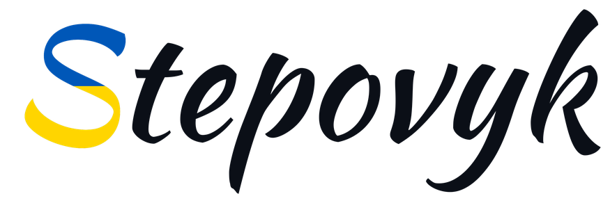

  <a href="https://stepovyk.github.io">
    <picture>
      <source media="(prefers-color-scheme: dark)" srcset="assets/stepovyk-logo-dark.png">
      
    </picture>
  </a>

Розробник з України · <a href="https://stepovyk.github.io">ігри українською</a> · застосунки <a href="https://www.steppe.workers.dev">Steppe</a>

---

### Ігри українською

Роблю безкоштовні повні українські локалізації ігор: весь текст, нові шрифти, встановлення за хвилину.

- **[Call of Duty: World at War](https://github.com/stepovyk/cod-waw-ukrainian)** – кампанія, зомбі, мультиплеєр, понад 9 600 рядків.
- **[Mount & Blade II: Bannerlord](https://github.com/stepovyk/bannerlord-ukrainian)** – 20 965 рядків, назви й імена відмінюються самі.
- **[RimWorld](https://github.com/Ludeon/RimWorld-Ukrainian/pull/40)** – уся українська перебрана заново, з усіма DLC.

Далі – уся серія Call of Duty (наступну частину обирають у [Telegram](https://t.me/stepovyk_ua)) і повний український дубляж Bannerlord. Усе в одному місці: **[stepovyk.github.io](https://stepovyk.github.io)**

### Застосунки Steppe

Прості й гарні застосунки для щоденного життя: без реклами, без стеження й без зайвого, українською та англійською.

- **[Смак](https://www.steppe.workers.dev/smak/)** – книга рецептів: страви з сайтів, фото й паперових зошитів, готування з таймерами, меню на тиждень і список покупок.
- **[Копійка](https://www.steppe.workers.dev/kopiyka/)** – облік витрат і бюджет: бюджети з денним лімітом, цілі, регулярні платежі, рахунки в різних валютах, спільний бюджет для родини.
- **[Обрій](https://www.steppe.workers.dev/obrii/)** – браузер для Android на рушії Gecko з блокуванням реклами й захистом від стеження. *У розробці.*

### Зв'язок

[stepovyk.github.io](https://stepovyk.github.io) · [Telegram](https://t.me/stepovyk_ua) · [www.steppe.workers.dev](https://www.steppe.workers.dev/#contact)

---

<b>English</b>

I'm a developer from Ukraine.

**Ukrainian game translations.** Free, complete Ukrainian localizations: [Call of Duty: World at War](https://github.com/stepovyk/cod-waw-ukrainian), [Mount & Blade II: Bannerlord](https://github.com/stepovyk/bannerlord-ukrainian) and [RimWorld](https://github.com/Ludeon/RimWorld-Ukrainian/pull/40). Next up: the rest of the Call of Duty series and a full Ukrainian voice dub for Bannerlord. Everything at [stepovyk.github.io](https://stepovyk.github.io).

**Steppe apps.** Simple, good-looking apps for everyday life, with no ads and no tracking: [Smak](https://www.steppe.workers.dev/en/smak/), a recipe book; [Kopiyka](https://www.steppe.workers.dev/en/kopiyka/), an expense tracker and budget; [Obrii](https://www.steppe.workers.dev/en/obrii/), a Gecko-based Android browser with ad and tracker blocking (in development).

[www.steppe.workers.dev/en/](https://www.steppe.workers.dev/en/) · [Telegram](https://t.me/stepovyk_ua)

