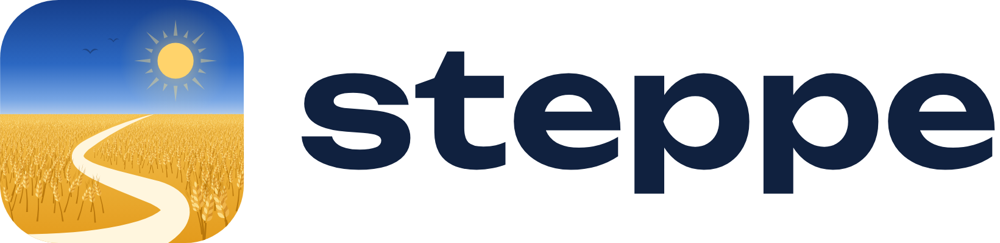

  <a href="https://www.steppe.workers.dev">
    <picture>
      <source media="(prefers-color-scheme: dark)" srcset="assets/steppe-logo-dark.png">
      
    </picture>
  </a>

<b>Stepovyk</b> · розробник з України · застосунки студії <a href="https://www.steppe.workers.dev">Steppe</a>

---

### Привіт! 👋

Під брендом **Steppe** я роблю прості й красиві застосунки для щоденного життя: без реклами, без стеження й без зайвого. Кожен застосунок повністю українською та англійською й працює без інтернету всюди, де це можливо.

### Застосунки

- 🍲 **[Смак](https://www.steppe.workers.dev/smak/)** – книга рецептів: страви з сайтів, фото й паперових зошитів, покрокове готування з таймерами, меню на тиждень і список покупок, що сам групується за відділами магазину.
- 🪙 **[Копійка](https://www.steppe.workers.dev/kopiyka/)** – облік витрат і бюджет: запис за секунди, бюджети з денним лімітом, цілі, регулярні платежі, рахунки в різних валютах за курсом НБУ, спільний бюджет для родини.
- 🧭 **Обрій** – браузер для Android на рушії Gecko з блокуванням реклами й захистом від стеження. *У розробці.*

### Чим працюю

Kotlin · Jetpack Compose · Room · WorkManager · Cloudflare Workers · D1 · Python

### Зв'язок

🌐 [www.steppe.workers.dev](https://www.steppe.workers.dev) · ✉️ [написати мені](https://www.steppe.workers.dev/#contact)

---

<b>English</b>

I'm a developer from Ukraine. Under the **Steppe** brand I build simple, good-looking apps for everyday life: no ads, no tracking, nothing extra. Every app is fully in Ukrainian and English and works offline wherever possible.

- 🍲 **[Smak](https://www.steppe.workers.dev/en/smak/)** – a recipe book: collect dishes from websites, photos and notebooks, cook step by step, plan the week's meals.
- 🪙 **[Kopiyka](https://www.steppe.workers.dev/en/kopiyka/)** – an expense tracker and budget: budgets with a daily limit, goals, recurring payments, multi-currency accounts, a shared family budget.
- 🧭 **Obrii** – a Gecko-based Android browser with ad and tracker blocking. *In development.*

🌐 [www.steppe.workers.dev/en/](https://www.steppe.workers.dev/en/) · ✉️ [contact me](https://www.steppe.workers.dev/en/#contact)

